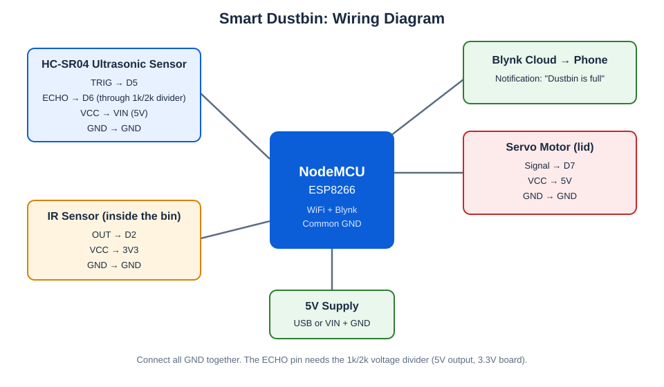
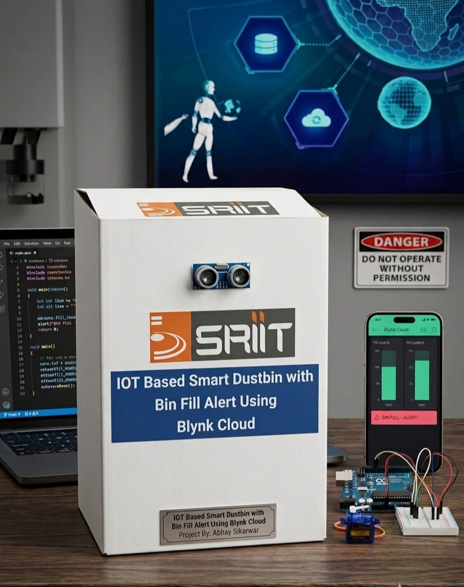

# 🗑️ Smart Dustbin

A touch-free dustbin built with an ESP8266 NodeMCU. An ultrasonic sensor detects when someone comes close and a servo motor opens the lid automatically. When the dustbin is full, an IR sensor detects it and a notification is sent to the phone through Blynk.

## 📌 Problem
Touching a dirty dustbin lid is unhygienic, and overflowing dustbins often go unnoticed until they are a mess. I wanted a dustbin that opens without touch and tells me when it needs to be emptied.

## 💡 Solution
- **Touch-free lid:** an ultrasonic sensor detects a person nearby and a servo motor opens the lid, then closes it again after the person leaves.
- **Full alert:** an IR sensor inside the dustbin detects when the garbage reaches the top and triggers a Blynk notification on the phone.

## 🔧 Components Used

| Qty | Component | Purpose |
|-----|-----------|---------|
| 1 | ESP8266 NodeMCU | Controller with WiFi |
| 1 | HC-SR04 ultrasonic sensor | Detects a person near the dustbin |
| 1 | Servo motor (e.g. SG90) | Opens and closes the lid |
| 1 | IR obstacle sensor module | Detects when the dustbin is full |
| 1 | 1 kΩ and 2 kΩ resistors | Voltage divider for the ultrasonic ECHO pin |
| 1 | 5V supply | Powers the NodeMCU and the servo |
| - | Jumper wires | Connections |

## ⚙️ How It Works
1. The ultrasonic sensor measures the distance in front of the dustbin every 100 ms.
2. If someone is closer than 20 cm, the servo opens the lid.
3. When the person moves away, the lid closes after 3 seconds.
4. The IR sensor is mounted inside the dustbin near the top. If garbage stays in front of it for 3 seconds (checked only while the lid is closed, to avoid false alarms), the dustbin is considered full.
5. The NodeMCU sends a Blynk event `bin_full`, which shows up as a notification on the phone. After the dustbin is emptied, the alert resets for the next time.

## 🔌 Circuit Connections

> ⚠️ Power everything OFF while wiring. **Connect all grounds (GND) together.**

### 1. HC-SR04 ultrasonic sensor → NodeMCU

| HC-SR04 pin | NodeMCU pin |
|-------------|-------------|
| VCC | VIN (5V) |
| GND | GND |
| TRIG | D5 |
| ECHO | D6 (through a voltage divider) |

**Important:** the ECHO pin outputs 5V but the NodeMCU pins are 3.3V. Use a voltage divider: ECHO → 1 kΩ → D6, and D6 → 2 kΩ → GND.

### 2. Servo motor → NodeMCU

| Servo wire | Connect to |
|------------|------------|
| Signal (orange / yellow) | D7 |
| VCC (red) | 5V (VIN or a separate 5V supply) |
| GND (brown / black) | GND (common) |

If the NodeMCU resets when the servo moves, power the servo from a separate 5V supply and join its GND with the NodeMCU's GND.

### 3. IR sensor → NodeMCU

| IR sensor pin | NodeMCU pin |
|---------------|-------------|
| OUT | D2 |
| VCC | 3V3 |
| GND | GND |

Mount the IR sensor inside the dustbin, near the top, pointing at the level where "full" should be detected. Adjust the small potentiometer on the module to set the detection range.

### 4. Power
Power the NodeMCU from a 5V supply through its micro-USB port (or VIN and GND).

## ▶️ How to Run

### A. Set up Blynk IoT
1. Create a free account at [blynk.cloud](https://blynk.cloud).
2. Create a **Template** (hardware: ESP8266, connection: WiFi) named `Smart Dustbin`.
3. In the template, go to **Events** and create an event with the code **`bin_full`** (name "Dustbin Full", type Warning/Critical). Turn on **notifications** for it.
4. Create a **Device** from the template and copy the **Template ID**, **Template Name** and **Auth Token**.
5. Install the Blynk IoT app on your phone and log in with the same account.

### B. Upload the code
1. Install the Arduino IDE. In Boards Manager install **esp8266** (by ESP8266 Community).
2. In the Library Manager install **Blynk** (by Volodymyr Shymanskyy).
3. Open `smart_dustbin/smart_dustbin.ino`.
4. Paste your Template ID, Template Name and Auth Token, and set your WiFi name and password.
5. Select the board **NodeMCU 1.0 (ESP-12E Module)** and upload.

### C. Tune
In the code you can change `OPEN_DISTANCE_CM`, `LID_OPEN_ANGLE`, `CLOSE_DELAY_MS` and `FULL_CONFIRM_MS` to match your dustbin. If the IR sensor works the other way round, set `IR_ACTIVE_LOW` to `false`.

## 🛠️ Tech Stack
C++ (Arduino framework for ESP8266), Blynk IoT, ultrasonic ranging, servo control

## 📸 Demo

## 🧠 Challenges & Learnings
- **Challenge:** detecting "full" reliably without false alarms. The IR sensor is checked only while the lid is closed, and the garbage must stay in front of it for a few seconds before a notification is sent.
- **Learned:** how ultrasonic sensors measure distance, how to control a servo motor, how to protect a 3.3V board from a 5V sensor signal, and how to send real-time alerts to a phone with Blynk.

 ## 👤 Author
   Abhaypratap Sikarwar
   [LinkedIn](https://www.linkedin.com/in/abhaypratap-sikarwar-a5b9792b1/) | [Portfolio](https://abhaysikarwar.netlify.app) | [Portfolio 2](https://abhaysikarwar326.netlify.app)
